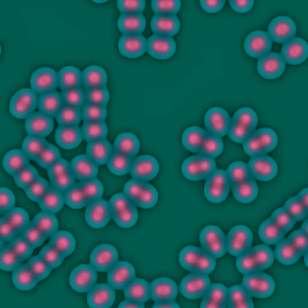
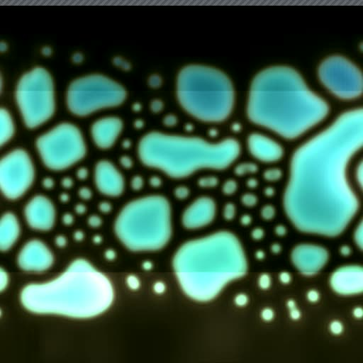
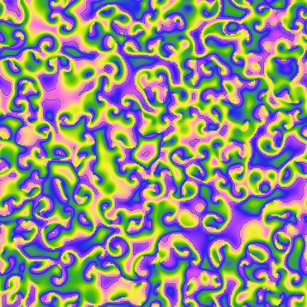
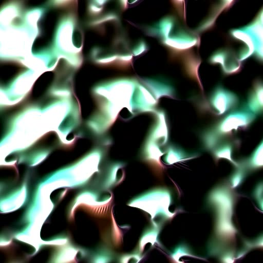
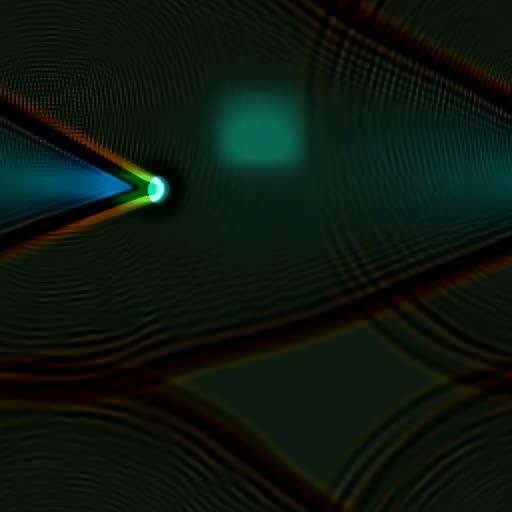
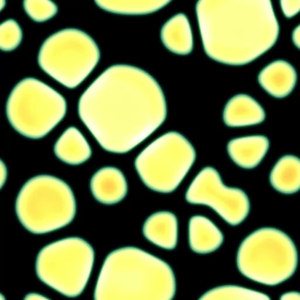

# rdui

**A playground for living patterns, in your browser.** Spots that grow and split, waves that spiral,
smoke that curls, sand that ripples, bubbles that rise like a lava lamp: each one a simple rule
run on every pixel at once on your GPU. Paint into them with your finger or mouse, push them
around, wall them in, change the rules as they run and watch what happens.

### ▶ [Open rdui](https://rdui.rdui.workers.dev) · [See clips](https://danwills.github.io/rdui/)

It needs a browser with WebGPU: recent Chrome or Edge on desktop or Android works best. It also
installs as an app on a phone.

<table>
<tr>
<td></td>
<td></td>
<td></td>
</tr>
<tr>
<td align="center">Gray-Scott: spots that grow and divide</td>
<td align="center">Lava lamp: bubbles rising warm, sinking cool</td>
<td align="center">Ginzburg–Landau: a sea of spiral waves</td>
</tr>
<tr>
<td></td>
<td></td>
<td></td>
</tr>
<tr>
<td align="center">Smoke: curling ribbons</td>
<td align="center">A glider meets a lamp</td>
<td align="center">Foam</td>
</tr>
</table>

### Things to try

- **Pick a rule** from the Rule tab: over a hundred, in families (Gray-Scott, bubbles, fluids,
  sand, lightning, mud cracks, Ginzburg–Landau…), many with ready-made scenes.
- **Paint** with the Tool tab: Seed adds chemistry, Erase removes it, Wall builds barriers.
  Push shoves fluids along like a paddle.
- **🎲 for new colours**, and the View tab for palettes, including one that blends every reagent.
- **Explore…** shows nine variants of the rule side by side: tap one to make it the new centre,
  and wander through the rule's space.
- **◧ split view**: the sim beside a live phase plot of its states (drag to turn, pinch to zoom),
  histograms and stats.
- **Record** a clip, or save every reagent as EXR frames.

Under the hood, rdui is a step towards a UI and contraption-building/exploring tool (and, one
day, a GUI framework) whose interfaces are made of live reaction-diffusion simulations. The rest
of this page is for people who want to run it locally or write their own rules.

## Running

```sh
npm install
npm run dev        # http://localhost:5173
npm run build      # typecheck + production build
```

Needs a WebGPU browser. On Linux, Chrome/Chromium may need
`--enable-unsafe-webgpu --enable-features=Vulkan`.

## Rules

A **rule** is a set of named reagents (up to 8), named parameters and an update
formula written in [Ready](https://github.com/GollyGang/ready)'s formula language,
compiled to a WebGPU compute shader (`src/rule.ts`). Semantics match Ready: Laplacians
use the 9-point stencil (1, 4, −20)/6 on the old values, the formula may reassign
reagents and sets `delta_x`, then `x += timestep * delta_x`. Formulas can also use
`bilaplacian_x` (Ready's 21-point stencil), `x_gradient_x`, `y_gradient_x` and
`gradient_mag_squared_x`; all are scaled by a `dx` parameter when the rule has one.

- **Built-in:** Gray-Scott, and Gray-Scott with History and Wave (a, b Gray-Scott; c a
  diffusing history; d, e a damped wave) with the "moreLifelike" parameters.
- **Phyllotaxis (Pennybacker):** a one-reagent Swift–Hohenberg-type model ported
  from Ready's hand-written kernel.
- **Ready patterns:** Dan's History-Wave family is bundled in `patterns/ready/` and
  any formula-rule `.vti` can be imported (formula, params, initial-pattern
  generator, render settings, zlib image data).
- **Paintable params:** any parameter can be made per-cell (🖌 in Global parameters,
  ✕ to make it global again; up to 7). The field is carried across the change.
- **Hidden reagents:** the view shows one reagent and can tint it by another, so
  reagents like the history c can drive behaviour without being the main display.
- **Memory + membranes:** *GS History+Wave+Memory* adds a bistable reagent m (stable
  at 0 and 1). A rule can declare a `membrane`: m can't diffuse between cells with a
  different painted `cell` id, so each compartment is a well-mixed memory cell.
  Gliders write it through `b_to_m` (> 0 sets, < 0 resets).
- **Rest state:** Erase, walls and Clear use the rule's homogeneous steady state,
  computed by relaxing a 1×1 wrapped grid (zero Laplacian).

## The sandbox

Every cell carries the rule's paintable parameters and a wall flag, so you build
contraptions by *painting* them:

| key | tool   | left drag                         | right drag / click        |
|-----|--------|-----------------------------------|---------------------------|
| 1   | Seed   | inject the rule's seed chemistry  | erase chemistry           |
| 2   | Erase  | reset reagents to rest            | —                         |
| 3   | Params | paint the paintable params        | eyedropper (sample cell)  |
| 4   | Wall   | no-flux barrier                   | remove wall               |
| 5   | Capture| drag a rectangle → new stamp      | —                         |
| 6   | Stamp  | place selected stamp (Q/E rotate, X mirror) | back to Seed    |
| 7   | Probe  | drag a rectangle → new probe      | remove probe under cursor |

Other keys: `space` run/pause · `.` single step · `[` `]` or wheel brush radius ·
`F` fill all with current params (keeps walls) · `R` reset · `C` clear chemistry · `V` cycle shown reagent ·
`T` cycle tint reagent ·
`Ctrl+S` / `Ctrl+O` save / load field · `Esc` cancel drag.

**Stamps** capture a rectangle's params, walls and chemistry, with reagent and param
names so they can be placed into other rules (matched by name). Starter stamps ship
in `stamps/*.json` (`+ Starters` adds them). They live in a library
(persisted in localStorage, exportable as JSON) and can be placed rotated/mirrored,
optionally only params+walls or only chemistry. Regions wrap around the torus.

**Probes** are rectangles measured on the GPU every few frames (mean and max of every
reagent, walls excluded), shown on the canvas and as sparklines of the shown reagent.

**Field files** (`.rdui`) hold the whole field, its rule and global values, and probes:
`RDUI` magic, version, JSON header, then raw float32 params and state. Version-1
(Gray-Scott only) files still load.

**Scenes** (`scenes/*.json`) are small declarative setups — rule, painted regions,
walls, placed stamps, probes, view — listed under *Scenes* in the rule menu.
`Glider → lamp`: a History+Wave glider lights a lamp painted with `c_damp = 0`; the
lamp keeps its history after the glider leaves while the trail elsewhere fades.

`Memory latch`: a set glider switches a compartment on, a reset glider switches it off;
each state holds by itself. `Soliton reflector (natural)`: a chain of five still
solitons turns gliders ~90° and survives; nothing in the reflector is painted.

Open a specific rule or scene directly with `#rule=<id>`, e.g. `#rule=scene%3Aglider-lamp`.

The feed/kill pad in the panel plots the classic presets and the saddle-node curve;
the hover readout shows u, v and params under the cursor.

## Lab

Headless experiments on the real GPU: `node lab/run.mjs <experiment> '<json>'` runs
`lab/<experiment>.ts` in Chrome (its own vite server, HMR off) and streams its log;
frames land in `lab/out/<experiment>/`, and `lab/mp4.sh` turns them into a video.
`lab/lab.ts` has helpers: build a sim for a rule, place stamps, paint, track blobs.

Findings so far (GS History+Wave):
- The glider is straight to ±0.5 px. Headings near an axis lock onto it; the axis
  glider stamp flies exactly along x. Speed ≈ 19 px per 1000 steps.
- Head-on, offset ≤ 4: both annihilate. Offset ≥ 6: both scatter ≈ ±70°.
- At right angles two gliders merge into one; its heading follows the timing offset
  (0° … 45° … 90°), with a wide window.
- With k = 0.065 a lone soliton is stable and gliders still run. A soliton eats a
  glider hitting it within ±6 px, launches as a second glider at ±8–12, and lets it
  pass at ±14. Chains of solitons spaced 16–20 deflect gliders 20–50° (90° in a narrow
  band) and stay intact, repeatedly.
- A soup search (all bundled patterns + F/k variants) found one glider family,
  14–20 px/k depending on the medium; no other spaceships yet.
- No breathing oscillators in History+Wave across F/k or history-feedback media.
- Natural glider sources: one soliton in F=0.054, k=0.064 (or k=0.0635) grows into a
  cluster that keeps shedding gliders — not periodic or aimed yet.
- Phyllotaxis medium (β = 3): at mu −0.2…−0.3 a lone spot is stable (a one-reagent
  still / bit); at mu −0.1…−0.02 one seed spot nucleates neighbours and a hexagonal
  crystal grows outward.

In dev builds, `window.rdui` exposes `sim`, `rule`, `globals`, `settings`, `probes`,
`stamps`, `applyRule` and `selectRule` for console tinkering.

## Layout

```
src/
  rule.ts              RuleDef, formula → WGSL compiler, initial patterns, built-in rules
  ready.ts             Ready .vti importer, bundled patterns
  scenes.ts            declarative scene format (scenes/*.json)
  sim.ts               Simulation: buffers, pipelines, step / brush / render / probe, rest relaxation
  shaders/brush.wgsl   capsule brush (seed, erase, params, wall, unwall)
  shaders/render.wgsl  palettes, parameter-map view, wall overlay
  shaders/probe.wgsl   per-region reduction (one workgroup per probe)
  probes.ts            ProbeSet: GPU measurement, async readback, history
  stamps.ts            Stamp model, rotate/mirror, thumbnails, library
  snapshot.ts          .rdui field file format
  overlay.ts           2D annotation layer (probes, drag rect, stamp ghost)
  ui.ts                side panel + feed/kill pad
  panels.ts            stamp library + probe list sections
  presets.ts           named (F, k) points
  main.ts              device setup, input, frame loop
```

## Roadmap

1. **Sandbox** — paintable multi-parameter field. *(done, first cut)*
2. **Stamps & probes** — capture/place reusable regions; GPU probes with history;
   whole-field save/load. *(done, first cut)*
3. **Rule engine** — multi-reagent formula rules, Ready import, hidden reagents,
   paintable params, scenes, starter stamps. *(done, first cut)*
4. **Widgets as attractors** (after Michael Levin's bioelectric "software on genetic
   hardware"): rules + per-cell params are the hardware, reagent state the software.
   A widget is a pattern with a slow memory of its target state that it regrows
   toward after damage; inputs are brief pulses that move it between attractors.
   - glider → lamp latch *(first cut; `c_damp = 0` is a leaky integrator — it slowly
     self-fills from the background)*
   - bistable memory reagent → a real toggle that a second glider switches off *(done)*
   - natural reflector from still solitons *(done)*; next: natural gun (a soliton
     source that a glider repeatedly launches), splitter, then NOT/NOR from merges
   - damage test: erase part of a widget, check it regrows to its stored state
   - glider gun: search emitter-region parameters for periodic glider sources
5. **Bubbles** — window-like regions as a phase-field (Allen–Cahn) territory reagent:
   organic boundaries, merge on contact (or abut, with two repelling fields), close by
   biasing φ so curvature flow shrinks them away; φ gates the contents' parameters.
6. **Dragging without forcing** — chemotaxis along painted parameter gradients;
   moving the memory layer and letting the pattern regrow at the target; wave steering.
7. **Framework** — a declarative API that composes widgets into live RD-backed UIs.
8. **Mobile pass** — alt-action toggle, rotate buttons, pinch radius, slide-up panel.

## License

rdui is free software under the GNU General Public License, version 3 or (at your option)
any later version (GPL-3.0-or-later): see [LICENSE](LICENSE). Credits for the third-party work it
includes (Ready, the colour maps, mp4-muxer) are in [NOTICE](NOTICE).
